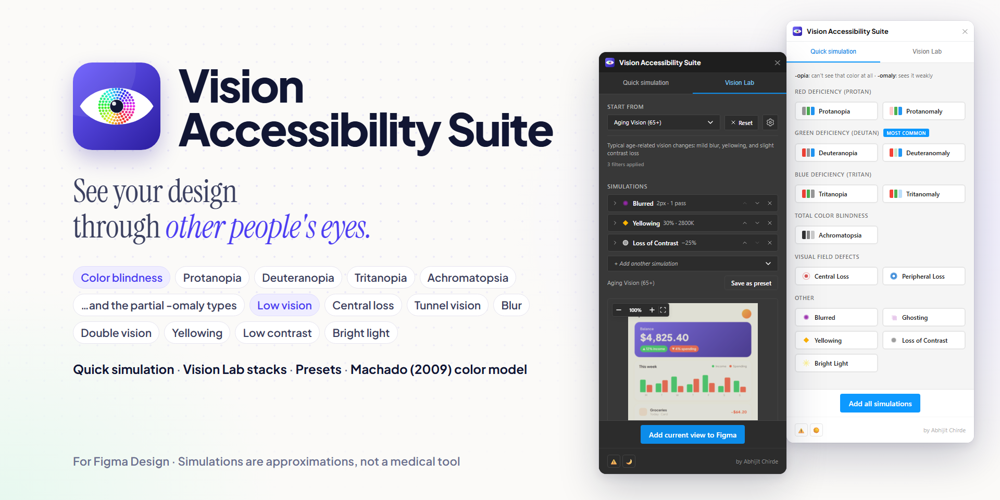

# Vision Accessibility Suite

A Figma plugin that shows how your design looks to people with color blindness, low vision and other vision conditions, so you can catch accessibility problems while you design.



## What it does

- **Quick simulation**: select a layer and click one of 14 simulations. A filtered copy is placed next to the design (in a row after earlier ones, and inside its Section if it has one). "Add all simulations" creates all 14 at once.
- **Vision Lab**: a live preview of the selection. Stack simulations to recreate real-life situations, tune each one with sliders, reorder them, zoom and pan the preview, and add the result to the canvas.
- **Presets**: five built-in presets (Advanced Cataracts, Aging Vision 65+ and 80+, Outdoor Viewing, Night Vision), plus your own: save a Vision Lab stack, duplicate, rename, import and export JSON. Custom presets are saved per user, so they work in every file.

The 14 simulations:

| Group | Simulations |
|---|---|
| Color blindness | Protanopia, protanomaly, deuteranopia, deuteranomaly, tritanopia, tritanomaly, achromatopsia |
| Visual field | Central loss (macular degeneration), peripheral loss (glaucoma, tunnel vision) |
| Other | Blurred, ghosting (double vision), yellowing, loss of contrast, bright light |

Simulations are approximations for design and learning, not a medical tool.

## How the simulations work

- **Color blindness** uses the Machado, Oliveira and Fernandes (2009) model ([`src/utils/machado-matrices.ts`](src/utils/machado-matrices.ts)): a matrix per deficiency at severities 0.0–1.0, interpolated between steps, applied in **linear RGB** (sRGB is converted to linear light and back with lookup tables). Achromatopsia uses Rec. 709 luminance.
- **Other filters** (blur, ghosting, yellowing, contrast, glare, visual field) are pixel operations in [`src/utils/image-utils.ts`](src/utils/image-utils.ts). Every filter goes through one registry, `applyFilterConfig`, used by Quick simulation, Vision Lab and presets alike.
- **Sizes are resolution-independent**: blur radius and ghosting offset are in design pixels, and visual field radii are a percentage of the design, so a filter looks the same on a button and on a full page. Designs are exported at 2x (lower for very large designs, to stay under Figma's 4096 px image limit), and the Vision Lab preview filters a downscaled copy for speed.

## Development

```sh
npm install
npm run build      # production build into dist/
npm run dev        # rebuild on change
npm run typecheck  # TypeScript check (should report no errors)
npm test           # filter, color blindness and preset tests
npm run community  # re-render the Figma Community images
```

To run it in Figma desktop: **Plugins → Development → Import plugin from manifest…** and pick `manifest.json`, then run it from **Plugins → Development → Vision Accessibility Suite**. After a rebuild, close and re-run the plugin.

Things that matter inside Figma:

- The UI runs in a sandboxed iframe: HTML `<form>` submission is blocked, so inline fields use buttons and key handlers instead.
- `figma.clientStorage` holds per-user data (custom presets, the selected preset, the theme choice).

## Project layout

| Path | What's there |
|---|---|
| `src/code.ts` | Plugin side: selection, export, creating frames, storage |
| `src/ui.tsx`, `src/components/` | Plugin UI (React): Quick simulation, Vision Lab, Preset Manager |
| `src/utils/` | Pure code: filters, Machado matrices, presets and validation, rendering helpers |
| `src/services/` | Selection events and per-user preset storage |
| `tests/` | `npm test` (Node's built-in test runner) |
| `documentation/community/` | Icon options, cover, slides and page text for the Figma Community, with their sources |
| `documentation/architecture.md` | How the plugin works: messages, rendering, filters, presets, storage |
| `documentation/improvement-plan-09112026.md` | The improvement plan and test checklists |
| `documentation/archive-2025-12/` | Older, out-of-date documentation, kept for reference |

## Preset files

A preset file is a JSON list of presets in format version 2:

```json
[
  {
    "version": 2,
    "id": "my-low-vision-preset",
    "name": "My low vision preset",
    "description": "Blur, less contrast and a dim centre",
    "filters": [
      { "type": "blurred", "config": { "radius": 3, "iterations": 2 } },
      { "type": "loss-of-contrast", "config": { "reduction": 0.4 } },
      { "type": "central-vision-loss", "config": { "radiusPercent": 25, "severity": 0.6 } }
    ]
  }
]
```

Filters run top to bottom. The Preset Manager in the plugin has a reference of every filter type, its settings and their ranges (the same ranges the import check uses, from `PRESET_FILTER_SPEC` in [`src/utils/preset-validation.ts`](src/utils/preset-validation.ts)). Files without `"version"` are the older format and are converted automatically.

## Author

Made by [Abhijit Chirde](https://abhijitchirde.com). License: ISC.
